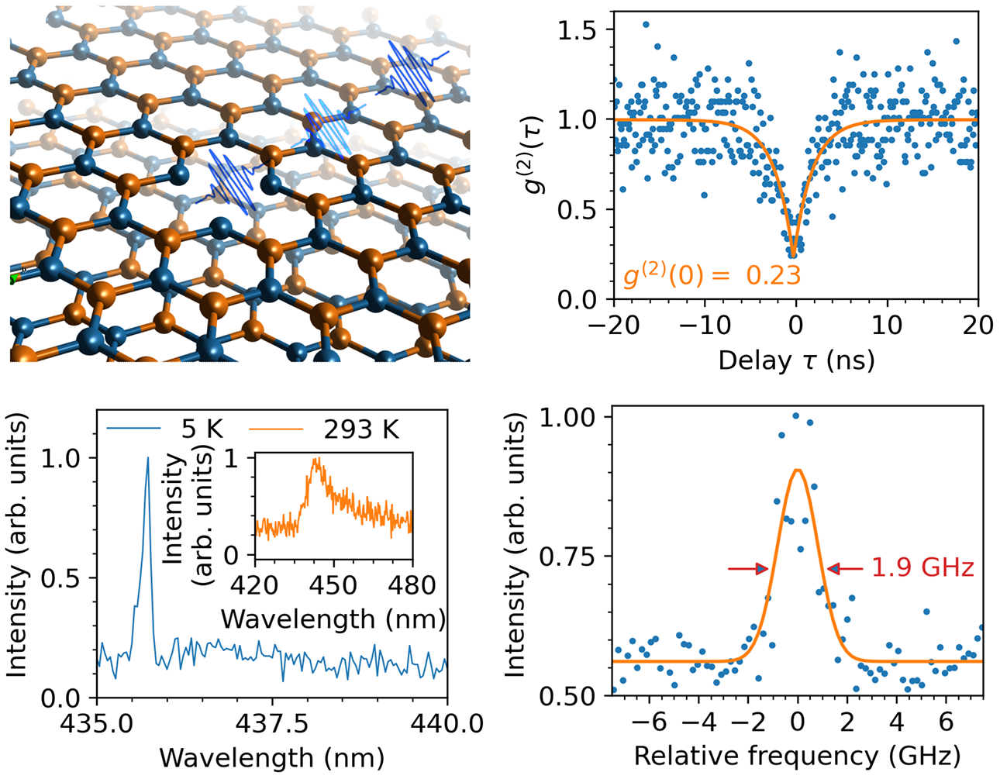
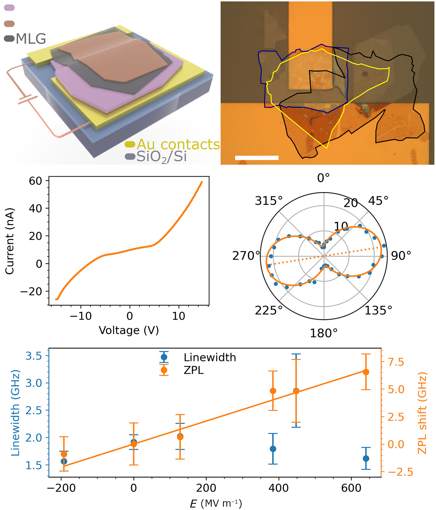
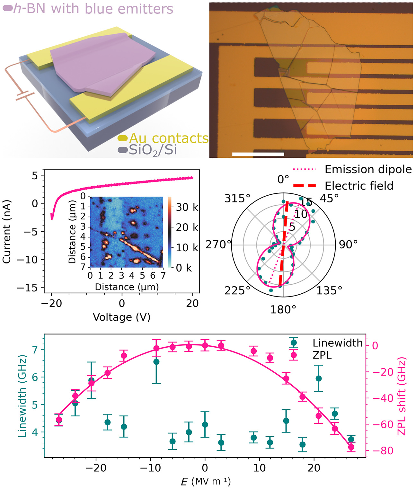
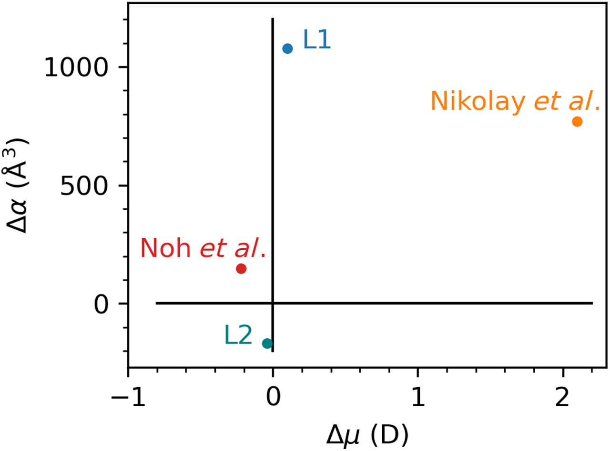
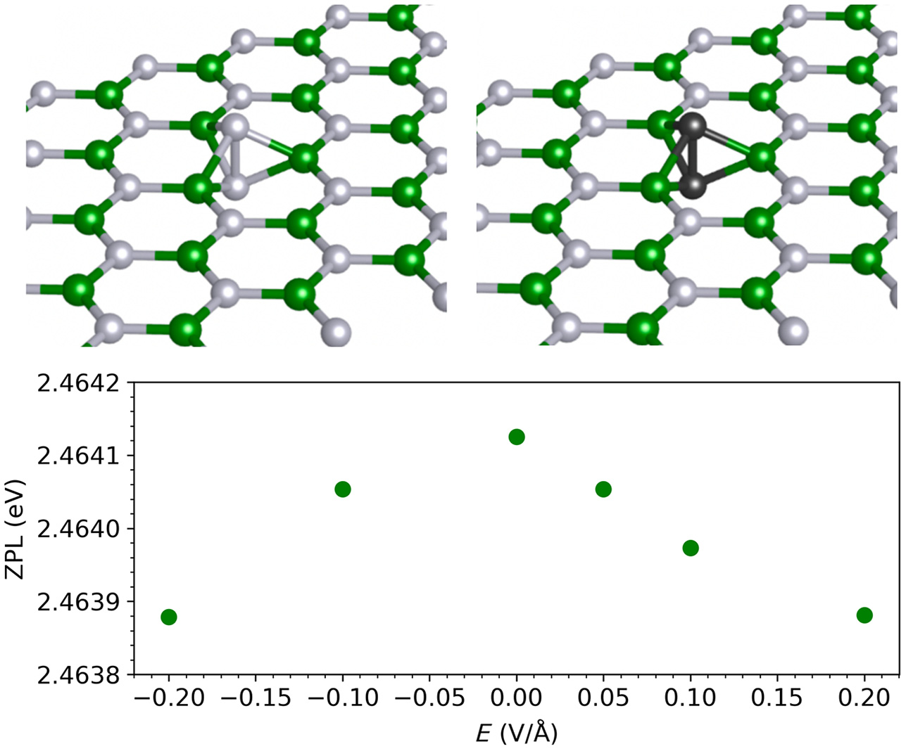

# Stark Effect of Blue Quantum Emitters in Hexagonal Boron Nitride

- Authors: Ivan Zhigulin, Jake Horder, Viktor Ivády, Simon J. U. White, Angus Gale, Chi Li, Charlene J. Lobo, Miloš Toth, Igor Aharonovich, Mehran Kianinia
- Journal: Physical Review Applied, 19(4), 044011 (2023)
- DOI: [10.1103/PhysRevApplied.19.044011](https://doi.org/10.1103/PhysRevApplied.19.044011)
- Keywords / Tags: #hBN #BlueEmitter #StarkEffect #SinglePhotonSource #PointDefects

---

## 執行摘要 (Executive Summary / TL;DR)
本論文研究了六方氮化硼 Hexagonal Boron Nitride (hBN) 中發射波長約為 436 nm 的 Blue Quantum Emitters 在外加電場下的 Stark Effect。透過獨立設計的垂直結構（施加面外電場）與橫向結構（施加面內電場），實驗證實該藍光色心表現出以二次方極化率為主導的 Quadratic Stark Effect，其永久電偶極矩趨近於零（$\mu \approx 0$）。研究團隊進一步結合密度泛函理論（DFT）計算，排除了傳統非對稱點缺陷，判定 $C_N^2$ 或氮分裂間隙複合體為最可能的對稱原子構型。此一近零偶極特性完美解釋了藍光發射體具備優異頻譜穩定度與極低 Spectral Diffusion 的深層物理機制。

---

## I. Introduction & Motivation (Why?)
- 現存問題與瓶頸 (Current Problem / Bottleneck)：  
  固態單光子源在積體量子光子學（Integrated Quantum Photonics）應用上的核心障礙為非均勻展寬（Inhomogeneous Broadening）。在 hBN 中，常見的可見光色心（580–650 nm）具有巨大的面外永久電偶極矩，易受周遭晶格中電荷躍遷所產生的波動微觀電場干擾，引發劇烈的光譜擴散（Spectral Diffusion）。相對地，波長在 436 nm 附近的 Blue Quantum Emitters 雖然具備極高的光子穩定性與高發光純度，但其對靜電場的響應機制過去尚未被系統性定量。
- 研究目標 (Research Objective)：  
  透過面內（In-plane）與面外（Out-of-plane）兩種電極幾何結構，精確量測 436 nm 藍光量子發射體的 Stark 位移行為，提取極化率變化 $\Delta\alpha$ 與永久偶極矩 $\mu$，並結合 DFT 理論計算判定其缺陷原子結構對稱性。

---

## II. Methods & Experimental Setup (How?)
- 樣本製備與色心生成 (Sample Preparation)：  
  利用微影與電子束照射（Focused Electron Beam, 商業 SEM）聚焦處理機械剝離之高品質多層 hBN 薄片，結合受控退火定點誘發 436 nm 藍光單光子中心。
- 垂直電極結構 (Vertical Device Architecture)：  
  將 36 nm 藍光 hBN 薄片轉移至金電極基板上，上方覆蓋半透明多層石墨烯（Multilayer Graphene, MLG）電極與保護性 hBN 頂層（Capping layer），用以施加面外（Out-of-plane）電場。
- 橫向電極結構 (Lateral Device Architecture)：  
  將約 100 nm 厚之 hBN 薄片轉移至間距為 2 μm 的叉指金電極（Interdigitated Gold Electrodes）上，用以施加面內（In-plane）電場。
- 光學量測系統 (Optical Characterization Setup)：  
  在低溫低溫恆溫器（$T = 5\text{ K}$）下使用微聚焦 Photoluminescence (PL) 與共振激發（PLE）光譜系統，並利用 Hanbury Brown–Twiss (HBT) 干涉儀量測二階自相關函數 $g^{(2)}(\tau)$。

---

## III. Figure & Table Deep Dive (關鍵圖表逐一深度解析)

### Figure 1: 藍光單光子發射體光學特性與線寬分析

<strong>FIG. 1. Blue single-photon emitters in h-BN.</strong> (a) Atomic defects in h-BN as a source of quantum emission. (b) Room-temperature autocorrelation measurement of a single defect in h-BN emitting photons at 436 nm. The solid line is a fit to the data. (c) Photoluminescence spectra of a blue emitter obtained at cryogenic temperature and room temperature. (d) Resonant excitation of a blue emitter fit with a Gaussian function with a linewidth of 1.9 GHz.

1. 視覺組件拆解：
   - (a) 原子級晶格缺陷模型：展示 hBN 二維蜂巢狀晶格中承載單光子發射之點缺陷微觀概念。
   - (b) 室溫二階自相關函數 $g^{(2)}(\tau)$ 直方圖：零延遲時間處展現明顯的反聚束凹陷，擬合實線在 $\tau = 0$ 處測得 $g^{(2)}(0) = 0.23$。
   - (c) 光致發光光譜 (PL Spectra)：對比 5 K 低溫（藍線）與 293 K 室溫（橘色內嵌圖），清晰顯示 436 nm 處銳利的 Zero-Phonon Line (ZPL)。
   - (d) 共振激發 (PLE) 掃描圖：以窄頻雷射對 ZPL 進行 10 次平均掃描，高斯擬合獲得單一發射峰線寬。
2. 資料與機制流向：
   - 電子束精確撞擊激發缺陷能階 → 405 nm 光學激發收集 PL → HBT 量測統計光子時間間隔 → 窄頻共振雷射定量頻譜展寬。
3. 物理意義與設計意圖：
   - 證實該發射體在室溫與低溫皆為純正單光子源（$g^{(2)}(0) \ll 0.5$），且共振線寬達到 1.9 GHz 之極低水準，確立其具備極低 Spectral Diffusion 的先決品質。
4. 關鍵量化結論：
   - ZPL 發射中心波長：436 nm（分散範圍小於 1 nm）。
   - 單光子純度：$g^{(2)}(0) = 0.23$（室溫未經背景扣除即符合單光子判準）。
   - 低溫共振激發線寬：1.9 GHz（Gaussian 峰形，遠優於一般可見光色心之數十至數百 GHz）。

---

### Figure 2: 垂直結構中面外電場之 Stark Effect 量測

<strong>FIG. 2. Stark effect in a vertical structure used to generate an out-of-plane electric field.</strong> (a) A vertical structure with h-BN located between the bottom gold electrode and a top MLG electrode. (b) Microscope image of the vertical device (the scale bar is 20 µm). Colored outlines show the edges of each layer: the h-BN layer hosting blue emitters is covered with MGL and a protective h-BN capping layer. (c) I-V characteristic of a vertical device at 5 K as measured under a bias from −15 to 15 V. (d) Emission polarization of the examined emitter in a vertical structure, which yields a polarization-visibility value of 0.83. (e) Emission linewidth and ZPL shift versus applied electric field determined by Eq. (3). A linear fit yields a gradient of 0.01 GHz MV⁻¹ m.

1. 視覺組件拆解：
   - (a) 垂直三明治幾何示意圖：底部金電極、36 nm h-BN 主動層、MLG 上電極與保護 capping 層。
   - (b) 元件實體顯微鏡光學影像：比例尺 20 μm，色線標明各材料邊界。
   - (c) 5 K 溫度下偏壓 −15 V 至 +15 V 之 I-V 曲線：漏電流僅數十 nanoamperes，證明焦耳熱可忽略。
   - (d) 發射偶極偏振極坐標圖：展現特徵「花生狀（Peanut shape）」輪廓，偏振可見度達 0.83。
   - (e) 電場調諧下之 ZPL 位移與發射線寬：藍點為線寬，橘點為 ZPL 偏移量。
2. 資料與機制流向：
   - 經由上下電極施加垂直面外電場 $F$ → 利用 Lorentz 局域場模型（$\varepsilon_{\text{out}} = 3.76$）校正電場強度 → 記錄不同偏壓下 ZPL 位移與線寬變化。
3. 物理意義與設計意圖：
   - 驗證面外方向是否存在顯著永久偶極矩。極坐標圖證實發射偶極嚴格取向於面內（In-plane），因此垂直電場幾乎無法引發顯著線性偶極作用。
4. 關鍵量化結論：
   - 面外電場調諧敏感度：線性擬合斜率僅 $0.01\text{ GHz MV}^{-1}\text{m}$（約合 $0.04\text{ meV V}^{-1}\text{nm}$）。
   - 面外永久電偶極矩：$\mu_{\perp} \approx 0$。
   - 線寬穩定度：全電壓區間發射線寬維持定值，證明電極接觸良好無局部熱效應。

---

### Figure 3: 橫向結構中面內電場之二次方 Stark Effect 響應

<strong>FIG. 3. Stark effect in a lateral structure used to generate an in-plane electric field.</strong> (a) A lateral structure with h-BN between two gold electrodes. (b) Microscope image of the lateral device (the scale bar is 50 µm). A h-BN flake is positioned on top of interdigitated gold electrodes, with gap separations of 2 µm. (c) I-V characteristic of the lateral device at 5 K from −20 to 20 V. The inset in (c) shows a room-temperature PL map from a confocal-microscope scan of a 7 × 7 µm² section of a h-BN flake used in the lateral structure. (d) Polarization plot of the emission dipole with a polarizability of 0.77, and orientation of the applied electric field from electrodes. (e) Linewidth and ZPL shifts versus applied electric field. The ZPL-shift data are fit to Eq. (2), yielding $\Delta\mu = 0.10\text{ D}$ and $\Delta\alpha = 1078\text{ \AA}^3$.

1. 視覺組件拆解：
   - (a) 橫向叉指電極示意圖：間距 $d = 2\text{ }\mu\text{m}$，產生純淨面內橫向電場。
   - (b) 光學顯微影像：比例尺 50 μm，展示覆蓋於金叉指電極上之 hBN 薄片。
   - (c) 5 K 下 −20 V 至 +20 V 之 I-V 曲線與共焦掃描 PL 強度熱圖（$7 \times 7\text{ }\mu\text{m}^2$ 範圍）。
   - (d) 發射偶極偏振度極坐標圖：發射偏振方向與局部電場方向夾角僅 18°。
   - (e) 電場位移二次擬合曲線：ZPL 頻率漂移對外加電場呈現高度對稱之拋物線變化。
2. 資料與機制流向：
   - 橫向雙極施加正負對稱偏壓 → 利用面內介電常數 $\varepsilon_{\text{in}} = 6.93$ 計算面內電場 → 觀察到正負電場皆朝同向紅移。
3. 物理意義與設計意圖：
   - 單位電場位移強度比垂直方向強 200 倍以上，且完全由對稱二次拋物線主導。直接以實驗證實面內永久偶極矩亦極小，能階位移由極化率差異（$\Delta\alpha$）完全主控。
4. 關鍵量化結論：
   - 永久躍遷偶極矩：$\Delta\mu = 0.10\text{ Debye}$（趨近於 0，無線性分量）。
   - 躍遷極化率變化量：$\Delta\alpha = 1078\text{ \AA}^3$（高極化率使激發態易被感應極化）。
   - 偏振取向夾角：$\theta = 18^\circ$。

---

### Figure 4: hBN 缺陷之偶極矩分量與極化率對照分佈

<strong>FIG. 4. Comparison of components of the transition dipole moment for emitters in h-BN.</strong> Values at L1 correspond to the first blue emitter examined in the lateral device. Values at L2 correspond to the second emitter in the same device. The other values are taken from Noh et al. and Nikolay et al.

1. 視覺組件拆解：
   - 橫軸為永久偶極矩變化 $\Delta\mu$（單位 Debye, D），範圍從 −1 至 +2.5 D。
   - 縱軸為極化率變化 $\Delta\alpha$（單位 $\text{\AA}^3$），範圍從 −200 至 +1200 $\text{\AA}^3$。
   - 標記點：L1（藍點，第一顆藍光色心）、L2（綠點，第二顆藍光色心）、Noh et al.（紅點，可見光色心）、Nikolay et al.（橘點，可見光色心）。
2. 資料與機制流向：
   - 匯總彙整文獻中不同光譜波段 hBN 色心的 Stark 參數，橫向對比偶極矩與極化率分佈空間。
3. 物理意義與設計意圖：
   - 提供全域視野，一目了然凸顯藍光色心與傳統可見光色心的本質差異：傳統發射體散落在高永久偶極矩區（$\Delta\mu \approx 2\text{ D}$），而藍光色心緊密聚攏在 $\Delta\mu \approx 0\text{ D}$ 軸線上。
4. 關鍵量化結論：
   - 藍光色心 L1：$\Delta\mu \approx 0.10\text{ D}$, $\Delta\alpha \approx 1078\text{ \AA}^3$。
   - 藍光色心 L2：$\Delta\mu \approx 0.05\text{ D}$, $\Delta\alpha \approx -180\text{ \AA}^3$（受局部晶格應力與電場方向微調影響）。
   - 結論：436 nm 色心的永久偶極矩比可見光色心小整整一個數量級以上。

---

### Figure 5: 候選點缺陷原子結構與 DFT 電場響應第一性原理計算

<strong>FIG. 5. Representation of (a) nitrogen split interstitial defect, (b) $C_N^2$ defect in the h-BN lattice, (c) the electric field dependence of the ZPL energy of the nitrogen split interstitial defect as obtained from first-principles calculations.</strong>

1. 視覺組件拆解：
   - (a) 氮分裂間隙缺陷（Nitrogen Split Interstitial）原子立體模型：兩個氮原子共用單一氮晶格位點。
   - (b) $C_N^2$ 碳複合缺陷晶格模型：兩個碳原子取代相鄰氮位點並維持高局部空間反演對稱。
   - (c) 第一性原理 DFT-PBE 計算曲線：ZPL 能量對外加電場 $E\text{ (V/\AA)}$ 之依賴性，呈現對稱之開口向下拋物線。
2. 資料與機制流向：
   - 依據群論推導具備 $D_{3h}$ 對稱性之晶格候選物 → 透過 DFT 模擬外加電場對波函數與電荷分佈之擾動 → 算出能階偏移二次方響應。
3. 物理意義與設計意圖：
   - 解釋實驗中「為何沒有線性項」的晶格起源：只有具備反演對稱或特定高對稱點群的結構（如 $C_N^2$ 複合體）才能在基態與激發態同時消除永久電偶極矩。
4. 關鍵量化結論：
   - 理論計算的 ZPL 能量對電場呈非線性二次響應，與實驗測得之 Quadratic Stark Effect 定性完全吻合。
   - 生成反應式 $C_B C_N + B_i \rightarrow C_N^2 + 2.0\text{ eV}$ 具備正能增益，證明 $C_N^2$ 在電子束照射下為熱力學穩定之結構候選者。

---

## IV. Results & Quantitative Findings (What?)
- 首次定量完成 hBN 436 nm 藍光量子發射體之雙向（面內/面外）靜電場 Stark Effect 響應。
- 確立藍光發射體之主控物理機制為 **Quadratic Stark Effect**，永久躍遷電偶極矩趨近於零（$\Delta\mu \approx 0.10\text{ D}$）。
- 測得巨觀面內躍遷極化率變化達 $\Delta\alpha = 1078\text{ \AA}^3$，提供大電壓下平滑調諧能力。
- 第一性原理計算成功指認 $C_N^2$ 碳複合中心為最吻合實驗對稱性特徵之微觀結構。

---

## V. Discussion, Limitations & Future Work (So What?)
- 物理推論 (Physical Interpretation)：  
  永久偶極矩趨近於零賦予了藍光發射體抗衡晶格微觀電荷雜訊（Charge Noise）的先天屏障，這解釋了為何藍光色心在無需主動空穴耗盡或表面鈍化的情況下，便能保有 Fourier-limited 等級的窄線寬與極致頻譜穩定性。
- 限制與瓶頸 (Limitations)：  
  缺乏線性 Stark 偶極意味著無法藉由微弱電壓實現大範圍的光學波長調諧；若要拉開數個奈米之頻率差，所需電場將逼近介電擊穿極限。
- 未來展望 (Future Work)：  
  建議後續研究採用應變工程（Strain Engineering）搭配二次電場調控，既保留近零偶極的高純度頻譜，又具備多發射體晶片級頻率同步之靈活性。

---

## Cross-Referenced Concepts (概念互聯)
- [Hexagonal Boron Nitride Defects](wiki/concepts/hbn-defects.md)
- [Blue Single-Photon Emitters](wiki/concepts/blue-quantum-emitters.md)
- [Stark Effect in 2D Materials](wiki/concepts/stark-effect-tuning.md)
