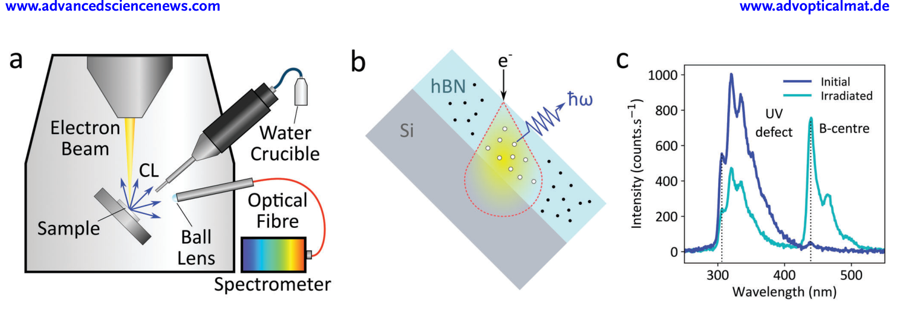
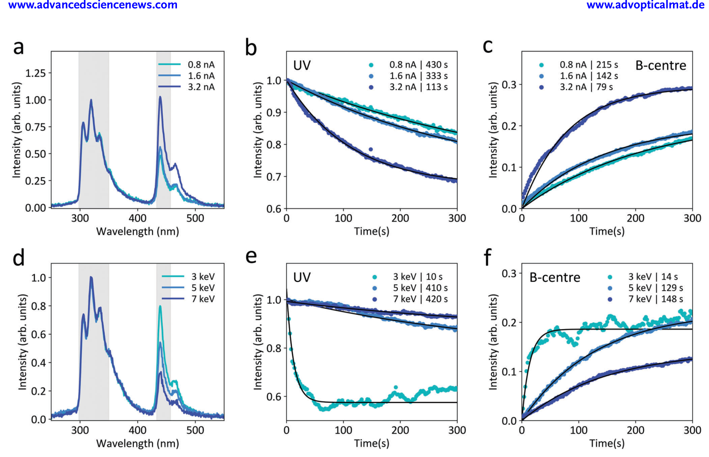
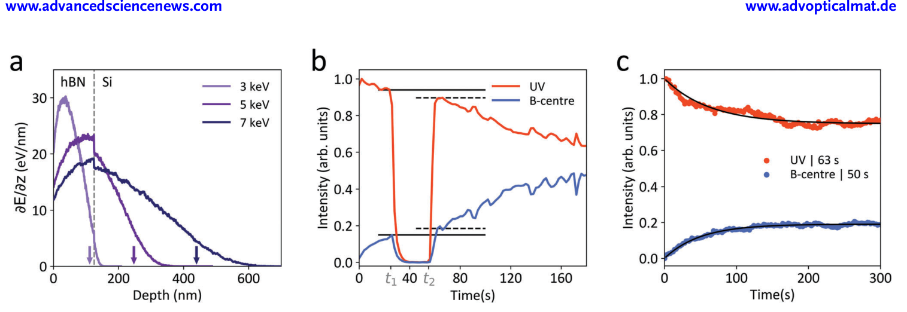
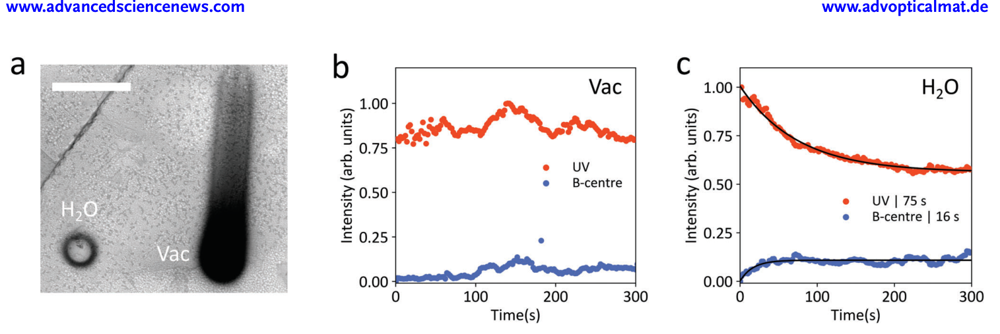
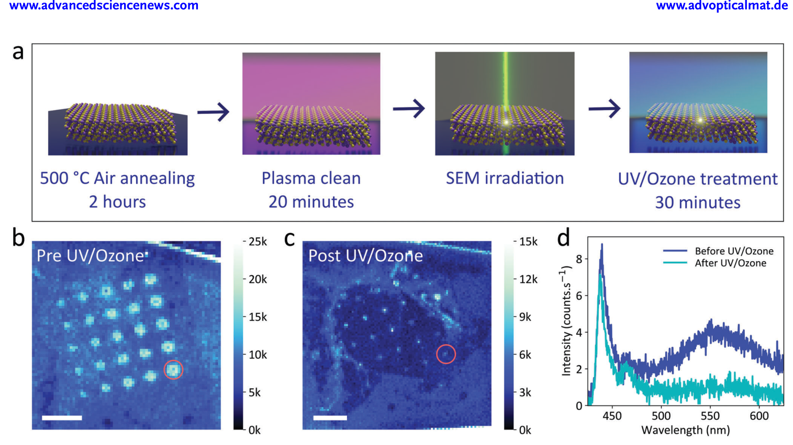

# Electron Beam Restructuring of Quantum Emitters in Hexagonal Boron Nitride

- **Authors**: Sergei Nedić, Karin Yamamura, Angus Gale, Igor Aharonovich, Milos Toth
- **Journal / Conference**: Advanced Optical Materials, 12(24), 2400908 (2024)
- **DOI / Link**: [10.1002/adom.202400908](https://doi.org/10.1002/adom.202400908)
- **Keywords / Tags**: #hBN #BlueEmitter #Bcenter #ElectronBeam #Cathodoluminescence #Electromigration #SinglePhotonSource

---

## Executive Summary (TL;DR)
本論文利用原位時間解析陰極射線發光（In Situ Time-Resolved Cathodoluminescence, CL）光譜學，系統性揭示了聚焦電子束在六方氮化硼 Hexagonal Boron Nitride (hBN) 中定點誘發 436 nm B-center 藍光量子發射體的動力學機制。研究證實，B-center 的生成伴隨著約 305 nm 碳相關紫外（UV）色心的淬滅，且兩者並非傳統假設的一步式碰撞游離（Impact Ionization）或缺陷團簇分解反應，而是受限於介電質充電效應所激發之內部電場（Internal Electric Field, $\xi$）驅動帶電缺陷之「電遷移（Electromigration）」。作者進一步突破了碳氫化合物表面污染的瓶頸，結合 500 °C 空氣退火、原位電漿清潔與非原位 UV 臭氧乾蝕刻，成功將可重現製備 B-center 的薄片厚度下限推進至 8 nm 超薄極限。

---

## I. Introduction & Motivation (Why?)
- **Current Problem / Bottleneck**：  
  在二維積體量子光子元件中，發射波長固定於 436 nm 的 B-center 因其優異的光譜同質性與純度備受矚目，且先前研究顯示其可透過電子束輻照定點生成。然而，該方法的重現性與生成效率極度不穩定，且過去僅能在厚層 hBN 薄片（$\gg 10\text{ nm}$）中成功製造；更關鍵的是，電子束生成 B-center 的微觀物理機制至今未明，是否源自 305 nm 碳相關缺陷的直接轉化亦存在長期爭議。
- **Research Objective**：  
  透過原位時間解析 CL 光譜定量分析電子束電流、電子能量對 UV 色心淬滅與 B-center 生成動力學（$t_{\text{sat}}$）的影響，釐清質量傳輸（電遷移）在此過程中的決定性作用；並提出一套標準化的樣品前處理與後處理工藝，消除表面碳氫污染，實現超薄 hBN（$< 10\text{ nm}$）中高純度 B-center 的確定性製備。

---

## II. Methods & Experimental Setup (How?)
- **Sample Preparation**：  
  使用膠帶機械剝離法將高純度碳摻雜 hBN 晶體（碳濃度約 $10^{19}\text{ atoms/cm}^3$，由日本 NIMS 提供）轉移至預先經丙酮/異丙醇超音波清洗及 UV 臭氧處理之矽（Si）基板上。部分樣品以高真空濺鍍沉積 7 nm 接地金薄膜進行對照實驗。樣品在送入 SEM 腔體前先經 500 °C 空氣退火（CL 樣品 12 小時，PL 樣品 2 小時），進入腔體後再以低壓空氣射頻電漿（RF Plasma）清潔 20–30 分鐘以去除表面吸附之有機污染物。
- **Electron Beam & In Situ CL Setup**：  
  在 ThermoFisher G4 雙束系統（DualBeam FIB/SEM）中進行電子束照射。樣品傾斜 45° 以優化收集效率，透過球透鏡（Ball lens）將發射光耦合至光纖，導入外部高靈敏度光譜儀（Ocean Optics QE Pro / QE65000）。以 2 秒積分時間連續記錄發光頻譜演變，照射總時長達 300 秒。
- **Ex Situ Photoluminescence (PL) & Ozone Treatment**：  
  電子束照射生成 B-center 陣列後，樣品在非原位環境下接受 30 分鐘 UV 臭氧乾蝕刻以去除電子束誘導沉積的碳質薄膜。隨後以架設共焦顯微鏡系統（405 nm CW 雷射激發、200 μW、100× 物鏡，NA = 0.90）進行單光子 PL 成像與光譜量測，並由 Hanbury Brown–Twiss (HBT) 系統量測二階自相關函數 $g^{(2)}(\tau)$。

---

## III. Figure & Table Deep Dive (關鍵圖表逐一深度解析)

### Figure 1: 電子束照射與陰極射線發光（CL）原位量測系統

<strong>Figure 1. Experimental setup used for electron irradiation of hBN and for CL spectroscopy.</strong> (a) Schematic of the SEM used in this work. (b) Close-up showing the electron interaction volume (dashed red line) in a flake of hBN on a Si substrate. Defects in hBN (black and white circles) within the interaction volume (white circles) are modified by the beam, and CL is emitted from defects excited by the electrons. (c) CL spectra showing the UV and B-center emissions at the start and end of a 300 s electron beam irradiation treatment. The UV and B-center ZPLs are indicated by vertical dashed lines. The UV and B-center emission intensities decrease and increase, respectively, as a result of the electron irradiation. (Spectrum integration time = 2 s, electron beam energy = 5 keV, beam current = 1.6 nA).

1. **視覺組件拆解**：
   - (a) SEM 腔體原位 CL 收集系統示意圖：顯示樣品台傾斜 45°、聚焦電子束、毛細管氣體注入系統（Capillary GIS）與收集光學元件（球透鏡與多模光纖）。
   - (b) 電子–固體交互作用體積（Interaction Volume，紅色虛線水滴輪廓）特寫：在 Si 基板上的 hBN 薄片中，未照射缺陷以黑圈表示，位於作用體積內的受激缺陷以白圈表示，展示 CL 發光與結構重組的空間範圍。
   - (c) 300 秒電子束照射（5 keV, 1.6 nA）前後之 CL 發射光譜：灰線代表初始狀態（$t = 0\text{ s}$，實測 2 秒積分），藍線代表照射 300 秒後；垂直虛線標記 UV 缺陷 ZPL（$\approx 305\text{ nm}$）與 B-center ZPL（$436\text{ nm}$）。
2. **資料與機制流向**：
   - 入射高能電子束穿透薄片激發載流子與晶格非彈性散射 → 初始光譜顯示強烈的 305 nm UV 發射及其縱向聲子伴随峰（Phonon Replicas 於 320、334、351 nm），此時 436 nm 處發光近乎為零 → 隨照射時間推移，UV 發射持續減弱淬滅，而 436 nm 處銳利的 B-center ZPL 及其聲子伴随峰（462、491 nm）強烈生長 → 頻譜變化呈現不可逆特性。
3. **物理意義與設計意圖**：
   - 證實聚焦電子束兼具「重組缺陷微觀結構」與「原位激發 CL 發光」的雙重功能，直接確立了 305 nm UV 色心與 436 nm B-center 在電子束作用下的此消彼長關聯。
4. **關鍵量化結論**：
   - UV 發射特徵：ZPL 位於 $\approx 305\text{ nm}$，伴隨三階 Phonon Replicas（320、334、351 nm）。
   - B-center 發射特徵：ZPL 位於 $436\text{ nm}$，伴隨兩階 Phonon Replicas（462、491 nm）。
   - 經 300 秒照射後，B-center 發光強度從雜訊背景激增至強烈發光，UV 訊號則呈現顯著淬滅。

---

### Figure 2: 電子束電流與能量對 CL 動力學的調控特徵

<strong>Figure 2. CL kinetics versus electron beam current and energy.</strong> (a) CL spectra from three regions of hBN were collected after each was irradiated for 300 s using a 5 keV electron beam, and beam currents of 0.8, 1.6, and 3.2 nA. (b) UV emission intensity versus electron beam irradiation time, at each beam current. (c) Corresponding B-center emission intensity versus time, at each beam current. (d) CL spectra from three regions of hBN were collected after each was irradiated for 300 s using electron beam energies of 3, 5, and 7 keV (beam current = 1.6 nA). (e) UV emission intensity versus time, measured at each beam energy. (f) Corresponding B-center CL intensity versus time, at each beam energy. In all cases, the rate of change of CL intensity increases with current and decreases with electron beam energy. (The spectrum integration time was 2 s. Each spectrum in a and d is normalized to the intensity of the first phonon sideband (PSB) of the UV emission. Each curve in b, c, e, and f is normalized to the CL intensity at zero time. Circles represent experimental data and black lines are fits obtained using Equations (1) and (2). Saturation times, tsat, extracted from the fits are shown in the legends.).

1. **視覺組件拆解**：
   - (a) 固定 5 keV 下，不同束流（0.8、1.6、3.2 nA）照射 300 秒後歸一化 CL 光譜。
   - (b, c) UV 淬滅強度與 B-center 生長強度隨照射時間變化的動力學曲線（圓點為數據，實線為單指數擬合 $I(t)$）。
   - (d) 固定 1.6 nA 下，不同電子能量（3、5、7 keV）照射 300 秒後歸一化 CL 光譜。
   - (e, f) 不同電子能量下 UV 淬滅與 B-center 生成的動力學曲線及擬合。
2. **資料與機制流向**：
   - 擬合公式分別採用飽和生長模型 $I = I_{\infty}(1 - e^{-t/t_{\text{sat}}})$ 與淬滅衰減模型 $I = I_{\text{init}} - I_{\infty}(1 - e^{-t/t_{\text{sat}}})$。
   - 電流增加（0.8 $\to$ 3.2 nA）時，$t_{\text{sat}}$ 顯著縮短，反應速率 $1/t_{\text{sat}}$ 加快；然而相同電流下，B-center 的 $t_{\text{sat}}$ 始終顯著短於 UV 缺陷（例如 0.8 nA 時，UV 的 $t_{\text{sat}} = 430\text{ s}$，而 B-center 僅為 $215\text{ s}$）。
   - 能量提高（3 $\to$ 7 keV）時，反應時間常數非線性劇烈拉長（3 keV 時 $t_{\text{sat}}$ 僅 10–14 秒，至 7 keV 時急增至 148–421 秒）。
3. **物理意義與設計意圖**：
   - 關鍵機制排除：若兩者為簡單的一對一直接轉化（如單純的碰撞游離或特定缺陷單元解離），其反應時間常數 $t_{\text{sat}}$ 必然相同；實驗中兩者 $t_{\text{sat}}$ 的系統性差異確鑿排除了「直接轉化」假說。
   - 長達數百秒的時間尺度排除了超快電子碰撞重組，表明反應必由晶格內帶電缺陷的擴散與質量傳輸（Electromigration）所限速。
4. **關鍵量化結論**：
   - 束流調控：在 5 keV 下，束流從 0.8 增至 3.2 nA，UV 的 $t_{\text{sat}}$ 由 430 秒降至 113 秒；B-center 的 $t_{\text{sat}}$ 由 215 秒縮短至 54 秒。
   - 能量依賴：在 1.6 nA 下，電子能量由 3 keV 升至 7 keV，UV 的 $t_{\text{sat}}$ 從 10 秒暴增至 421 秒；B-center 的 $t_{\text{sat}}$ 從 14 秒激增至 148 秒，呈現超線性（Superlinear）延遲。

---

### Figure 3: 能量密度 $\varepsilon$ 與內建電場 $\xi$ 在電遷移中的決定性角色

<strong>Figure 3. Role of energy density ɛ and the electric field 𝝽 in CL kinetics.</strong> (a) Simulated depth distributions of the energy loss rates (∂E/∂z) of electrons incident on a 125 nm flake of hBN on bulk Si, calculated for electron energies of 3, 5, and 7 keV. The range (Z), indicated by arrows, is defined here as the mean depth (z) at which 95% of the energy has been dissipated. (b) UV and B-center CL intensity measured as a function of electron beam irradiation time. The irradiation was interrupted at time t1 for 30 s and resumed at t2. The solid and dashed black lines show the CL intensities at t1 and t2, respectively. The intensities continue to change while the irradiation is interrupted because 𝝽 does not dissipate instantaneously when the irradiation is interrupted. (c) UV and B-center CL intensity versus electron beam irradiation time, measured from a hBN flake coated with a 7 nm grounded gold film. The coating causes an increase in the CL kinetics rates, indicated by the short values of tsat specified in the legend. (The electron beam energy and current were 5 keV and 1.6 nA. In (b) the beam was defocused to a diameter of ≈40 nm to minimize the effect of errors in the beam placement accuracy when the irradiation was resumed at t2.).

1. **視覺組件拆解**：
   - (a) Monte Carlo 模擬之電子能量沉積率深度分佈 $\partial E/\partial z$：對比 3、5、7 keV 電子注入 125 nm hBN/Si 的能量耗散深度，箭頭標記 95% 能量耗散之電子穿透射程 $Z$。
   - (b) 電子束遮斷（Beam Blanking）實驗：於 $t_1$ 瞬間切斷電子束 30 秒，並於 $t_2$ 恢復照射，黑色實線與虛線分別標示中斷前後的發光強度。
   - (c) 接地導電金膜（7 nm Au）覆蓋對照組的動力學曲線：固定 5 keV、1.6 nA 下測得之 UV 淬滅與 B-center 生長曲線。
2. **資料與機制流向**：
   - 能量分佈解析：低能電子（3 keV）之交互作用體積大幅縮小（射程 $Z \approx 111\text{ nm}$，完全局域於薄片內），其沉積能量密度 $\varepsilon \approx 9 \times 10^{-4}\text{ eV/nm}^3$，相較 7 keV（$\varepsilon \approx 3 \times 10^{-5}\text{ eV/nm}^3$）高出 30 倍，促進了化學鍵斷裂與游離反應速率 $R = \varepsilon I$。
   - 中斷實驗機制：在 $t_1 \to t_2$ 關閉電子束期間，無任何電子碰撞，但 $t_2$ 剛恢復時測得之 UV 強度進一步下降，B-center 強度則進一步升高，證明在束流停止期間晶格重組仍在自發進行。
   - 接地薄膜效應：金薄膜將表面電位鉗位至地電位，使充電產生的電位差終止距離 $s$ 大幅縮短至樣品表面，根據 $|\xi| = -dV/ds$，內部電場強度 $|\xi|$ 顯著增強，使電遷移速度呈數量級飆升。
3. **物理意義與設計意圖**：
   - 徹底排除了「純碰撞引發結構轉化」與「局部焦耳熱效應」假說（金層具備高熱導性，若熱為關鍵，高散熱應抑制反應而非大幅加速）。
   - 決定性證實：缺陷重組的核心驅動力是「介電質充電建立的強內部靜電場 $\xi$」，誘發帶電缺陷在晶格中定向電遷移。
4. **關鍵量化結論**：
   - 能量密度變化：電子能量由 7 keV 降至 3 keV，能量沉積密度 $\varepsilon$ 從 $3 \times 10^{-5}$ 躍升至 $9 \times 10^{-4}\text{ eV/nm}^3$（增強達 30 倍）。
   - 金膜接地加速效果：在 5 keV、1.6 nA 下，接地 7 nm 金膜將 UV 的 $t_{\text{sat}}$ 由 333 秒急縮至 63 秒，B-center 的 $t_{\text{sat}}$ 由 142 秒急縮至 50 秒，速率提升達 3–5 倍。

---

### Figure 4: 碳氫化合物表面污染對生成製程的破壞與抑制效應

<strong>Figure 4. Role of hydrocarbon contaminants in CL kinetics.</strong> (a) SEM image showing two adjacent regions of hBN irradiated in high vacuum (“Vac,” pressure ≈3.2 × 10−6 mBar) and in the presence of H2O vapor (≈1.5 × 10−5 mBar), using a 10 keV electron beam (1.6 nA, 300 s per irradiation). The scale bar is 5 μm. (b) UV and B-center CL intensity measured versus time during the high vacuum electron beam irradiation. (c) UV and B-center CL intensity measured versus time during the irradiation performed in the presence of H2O. The sample contained an excessive amount of hydrocarbon contaminants which inhibited the B-center electron beam generation process. The problem was mitigated by injecting H2O into the SEM chamber.

1. **視覺組件拆解**：
   - (a) 高真空（Vac）與水氣輔助（$\text{H}_2\text{O}$）條件下照射 300 秒之 SEM 二次電子影像（比例尺 5 μm）：Vac 區域呈現黑色積碳圓斑與束流漂移拖尾；$\text{H}_2\text{O}$ 區域中央維持清潔，外圍環繞背散射電子沉積之碳質光暈（Dark Halo）。
   - (b) 高污染樣品於高真空下照射之 CL 動力學：發光訊號劇烈波動且無常規飽和曲線，B-center 生成完全失敗。
   - (c) 引入水氣（壓力由 $3.2 \times 10^{-6}$ 升至 $1.5 \times 10^{-5}\text{ mBar}$）下之 CL 動力學：恢復平滑指數動力學，且反應速率顯著提升。
2. **資料與機制流向**：
   - 電子束打擊表面殘留碳氫化合物分子 $\to$ 鍵結交聯沉積為非晶碳膜 $\to$ 碳膜消耗入射電子能量並干擾介電質表面充電，引發電子束嚴重漂移與色心生成抑制。
   - 引入水分子蒸氣 $\to$ 電子活化表面水解離產生活性氧基團，原位化學乾蝕刻（Dry Chemical Etching）碳質沉積物，同時游離水分子穩定表面電位，顯著增強 $|\xi|$。
3. **物理意義與設計意圖**：
   - 揭露了文獻中電子束誘發 B-center 失敗率高、重現性差的罪魁禍首為環境與轉移殘留的碳氫聚合物薄膜，並驗證了透過原位氧化乾蝕刻恢復生成活性的物理可行性。
4. **關鍵量化結論**：
   - 水氣保護效果：在 10 keV 下，水氣注入成功將完全失控的製程修復，達到 UV $t_{\text{sat}} \approx 75\text{ s}$ 與 B-center $t_{\text{sat}} \approx 16\text{ s}$，其速率甚至遠快於常規清潔樣品於 10 keV 的預期反應時間（$> 128\text{ s}$）。

---

### Figure 5: UV 臭氧處理消除寬頻背景螢光與超薄 hBN 陣列建構

<strong>Figure 5. Suppression of background fluorescence by UV ozone processing.</strong> (a) Protocol used to generate B-centers. Exfoliated hBN was annealed in air prior to transfer to an SEM chamber where it was plasma cleaned before irradiation in high vacuum by an electron beam. Subsequently, an ex situ UV ozone treatment was used to dry etch carbon and suppress background fluorescence. (b) Confocal PL map collected before ozone exposure, showing a 5 × 5 array of B-centers generated by an electron beam (energy = 3 keV, current = 1.6 nA, five doses in the range of 1.0 × 1010 to 2.5 × 1011 electrons per spot, repeated five times). (c) PL map of the same array after a 30 min UV ozone treatment. The treatment caused a reduction in the diameter of each spot in the array. (d) PL spectra from the spot circled in (a) and (b) were acquired before (teal) and after (blue) UV ozone exposure, showing suppression of a broad background emission centered on ≈550 nm. The scale bars in (b) and (c) designate 10 μm.

1. **視覺組件拆解**：
   - (a) 最佳化製備流程圖：包含機械剝離 $\to$ 500 °C 空氣退火（2 小時） $\to$ SEM 原位空氣射頻電漿清洗（20 分鐘） $\to$ 高真空 3 keV 電子束照射 $\to$ 非原位 UV 臭氧乾蝕刻（30 分鐘）。
   - (b, c) 405 nm 激發下 $5 \times 5$ 定點發射體陣列的共焦 PL 強度分佈圖（臭氧處理前 vs 處理後，比例尺 10 μm，電子劑量 $1.0 \times 10^{10}$ 至 $2.5 \times 10^{11}$ electrons/spot）。
   - (d) 單一發射亮點在臭氧處理前後的 PL 光譜（綠線為處理前，藍線為處理後）：直觀對比 550 nm 處寬頻背景發光的抑制效果。
2. **資料與機制流向**：
   - 儘管在超高真空下照射，聚焦電子束仍會將周邊微量碳源固化在發射點表面形成數奈米碳膜。
   - 405 nm 雷射激發下，碳膜產生中心位於 550 nm 的巨大非晶碳寬頻螢光，嚴重淹沒 436 nm B-center 訊號；經 30 分鐘 UV 臭氧乾蝕刻後，碳膜被徹底揮發清除，PL 圖中發射光點半徑大幅收縮，550 nm 背景噪聲完全消失，顯露出高純度的 436 nm 單一峰發光。
3. **物理意義與設計意圖**：
   - 確立了製備高單光子純度 B-center 的標準工藝閉環，克服了背景螢光干擾，並首次成功在薄至 8 nm 的極薄 hBN 薄片中定點實現單光子發射體陣列。
4. **關鍵量化結論**：
   - 背景抑制率：30 分鐘 UV 臭氧處理將 550 nm 處的非晶碳寬頻背景發光壓制超過一個數量級。
   - 劑量與厚度極限：電子束能量優化至 3 keV（1.6 nA），以 $1.0 \times 10^{10} - 2.5 \times 10^{11}\text{ electrons/spot}$ 之極低劑量即可誘發量子中心，並在薄至 8 nm 的 hBN 奈米薄片中成功觀測到清晰的 436 nm B-center。

---

## IV. Results & Quantitative Findings (What?)
1. **電遷移主導之結構重組動力學**：
   - B-center 的生成與 305 nm UV 缺陷的淬滅並非 1:1 的直接轉化（$t_{\text{sat}}$ 數值顯著分離），而是由介電質充電形成的內部靜電場 $\xi$ 驅使帶電缺陷在晶格中漂移所限速。
   - 能量沉積密度 $\varepsilon$ 隨入射能量降低而暴增（3 keV 達 $9 \times 10^{-4}\text{ eV/nm}^3$），促使鍵結斷裂與游離反應速率 $R = \varepsilon I$ 大幅提升。
2. **靜電場調控與接地效應**：
   - 束流中斷（Beam Blanking）實驗顯示，在切斷電子束 30 秒期間，缺陷遷移與光譜演變仍持續進行，排除了純彈性/非彈性電子碰撞直接成鍵的單步機制。
   - 表面覆蓋 7 nm 接地金膜可顯著縮短電位終止距離 $s$，使電場 $|\xi| = -dV/ds$ 劇增，將飽和時間常數縮短 3–5 倍（UV $t_{\text{sat}}$ 降至 63 s，B-center $t_{\text{sat}}$ 降至 50 s）。
3. **超薄層極限製備能力**：
   - 透過 500 °C 空氣退火 + 原位空氣電漿 + 3 keV 低能量照射 + 30 分鐘非原位 UV 臭氧乾蝕刻之組合工藝，完全排除了表面碳質薄膜的干擾，成功將 B-center 製造門檻由過往的 $\gg 10\text{ nm}$ 推進至 **8 nm** 的極薄層極限。

---

## V. Discussion, Limitations & Future Work (So What?)
- **Physical Interpretation & 缺陷微觀構型推測**：
  - 實驗證實 B-center 僅能在具備 305 nm 碳相關 UV 發射的樣品中生成，且需要電遷移過程介入。這強烈暗示 B-center 涉及帶電間隙原子（如碳間隙或氮分裂間隙）在電場驅動下遷移至特定空位（如硼空位 $V_B$ 或碳取代位 $C_N$）結合而成複合體（如 $C_B V_N$ 或碳對複合結構），支持了碳原子參與 B-center 結構核心的假說。
- **Unresolved Questions / Limitations**：
  - 在極薄薄片（$< 10\text{ nm}$）中生成的 B-center 表現出較明顯的光學不穩定性（Blinking 與 Spectral Diffusion），這可能源自表面鄰近介電界面態與電荷陷阱的干擾。
- **Inspiration for Future Research**：
  - 提供了與微納光子結構（如 Photonic Crystal Cavity）精準集成的工藝參數指南（建議固定電子能量於 $\approx 3\text{ keV}$）。
  - 未來可結合高介電常數或導電鈍化層（如石墨烯或原子層沉積氧化物）進一步抑制超薄層中的光譜擴散，推動可擴展晶片級量子光子電路的實用化。

---

## Cross-Referenced Concepts (概念互聯)
- [[blue-quantum-emitters|Blue Single-Photon Emitters]]：B-center 436 nm 零聲子線的光學同質性與電子束定點誘發機制。
- [[hbn-defects|Hexagonal Boron Nitride Defects]]：305 nm 碳相關 UV 缺陷、硼空位 ($V_B^-$) 與點缺陷複合體構型探討。
- [[stark-effect-tuning|Stark Effect in 2D Materials]]：內部充電靜電場 $\xi$ 與外部電極調諧之介電質極化響應。
