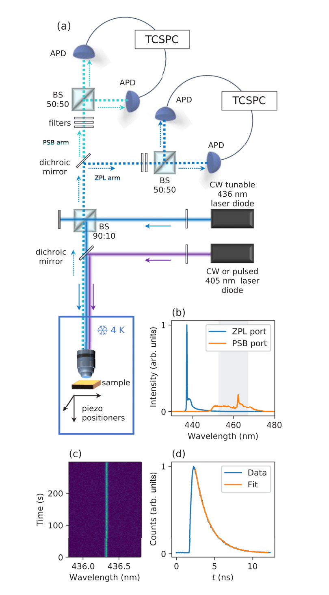
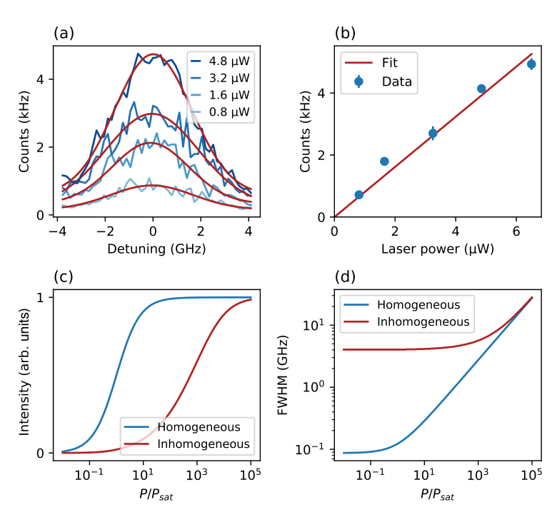
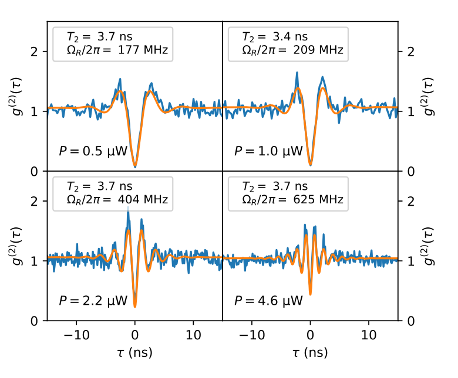
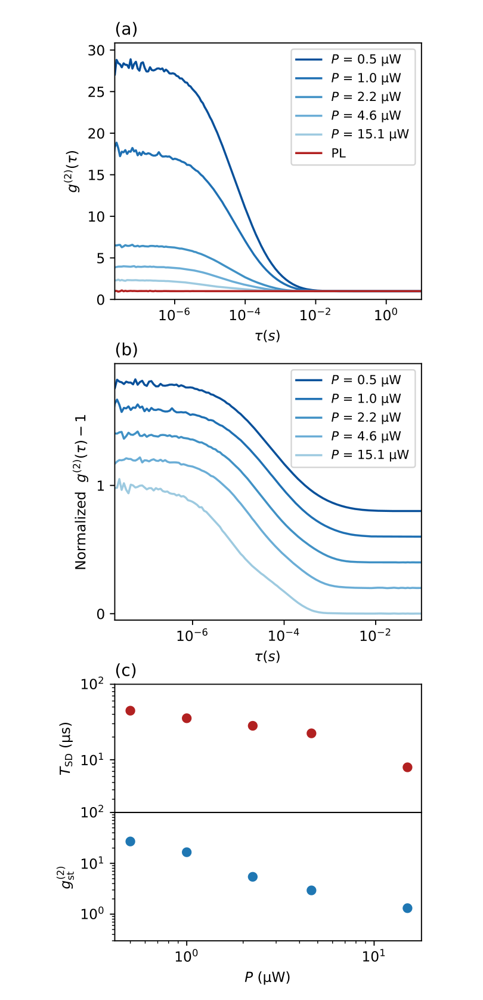
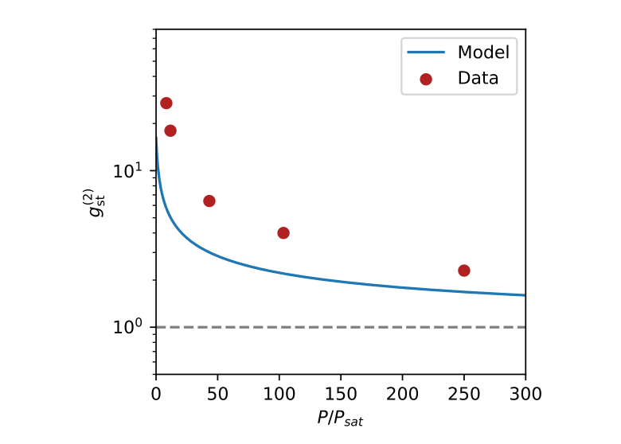

# Investigating the fast spectral diffusion of a quantum emitter in hBN using resonant excitation and photon correlations

- Authors: Clarisse Fournier, Kenji Watanabe, Takashi Taniguchi, Julien Barjon, Stéphanie Buil, Jean-Pierre Hermier, Aymeric Delteil
- Journal: Physical Review B, 107(19), 195304 (2023) - Editors' Suggestion
- DOI: [10.1103/PhysRevB.107.195304](https://doi.org/10.1103/PhysRevB.107.195304)
- Keywords / Tags: #hBN #SpectralDiffusion #ResonantExcitation #PhotonCorrelation #BCenters #FourierLimited

---

## 執行摘要 (Executive Summary / TL;DR)
本論文提出了一種結合共振雷射激發（Resonant Laser Drive）與跨越十個時間數量級二階光子自相關函數 $g^{(2)}(\tau)$ 的創新規範，成功破解了六方氮化硼 Hexagonal Boron Nitride (hBN) 中藍光量子發射體（B centers，~436 nm）長久以來的頻譜展寬謎題。研究證實，該發射體在低溫下測得的 4.0 GHz 非均勻展寬源自於特徵時間尺度為數十微秒（$T_{\text{SD}} \approx 10\text{--}50\text{ }\mu\text{s}$，對應數十 kHz 跳躍頻率）的**快速光譜擴散（Fast Spectral Diffusion）**；更關鍵的是，在每次頻譜跳躍之間，該色心發射出同質相干時間達到極限（$T_2 \sim 2T_1 \approx 3.7\text{ ns}$）的 **Fourier-limited** 單光子，單次跳躍前可連續發射高達 $10^4$ 顆全同光子。

---

## I. Introduction & Motivation (Why?)
- 現存問題與瓶頸 (Current Problem / Bottleneck)：  
  固態單光子源（SPE）不可避免地受環境干擾而發生去相位（Dephasing），其中由環境電荷波動引發的靜電微觀場波動會導致光譜擴散（Spectral Diffusion）。當光譜擴散的時間尺度快於光子偵測率的倒數時，傳統的光譜量測技術無法解析此類動態，僅能測得嚴重展寬的非均勻光譜包絡（Inhomogeneous Lineshape）。傳統干涉法或窄頻濾波法受限於光子收集效率與解析度，無法同時提供高時間與高頻譜解析度。
- 研究目標 (Research Objective)：  
  利用共振激發將發射體頻率的「微觀波動」轉換為散射光子的「強度起伏」，藉由測量全時間尺度（奈秒至十秒）的二階光子相關函數 $g^{(2)}(\tau)$，同時定量萃取發射體的同質相干時間 $T_2$ 與快速光譜擴散特徵時間 $T_{\text{SD}}$。

---

## II. Methods & Experimental Setup (How?)
- 樣本製備與色心生成 (Sample Preparation)：  
  以高溫高壓（HPHT）生長之高品質單晶 hBN，機械剝離至 $\text{SiO}_2(285\text{ nm})/\text{Si}$ 基板上，經 15 kV 加速電壓之電子束照射，定點誘發生成 436 nm 藍光單光子色心（B centers）。
- 低溫微共焦光譜系統 (Cryogenic Confocal Setup)：  
  樣品置於 4 K 封閉循環式氦低溫恆溫器中，以數值孔徑 $\text{NA} = 0.8$ 之物鏡進行單一色心共焦激發與收集。
- 雙雷射激發架構 (Excitation Schemes)：  
  配備 405 nm 非共振雷射（連續波或脈衝）以及 ~436 nm 連續波共振雷射（頻率鎖定至外部超高穩定光學腔，線寬遠小於發射體線寬，波長可連續平滑調諧）。
- 聲子邊帶過濾與偵測機制 (PSB Filtering & HBT Detection)：  
  利用二色向分色鏡（Dichroic Mirror）將發射光分離為零聲子線（ZPL）與聲子邊帶（PSB，紅移 ~160 meV）。在進行共振激發時，僅收集 PSB 光子至單模光纖並導入 Hanbury Brown–Twiss (HBT) 崩潰光電二極體（APD）系統，徹底消除共振雷射散射背景。

---

## III. Figure & Table Deep Dive (關鍵圖表逐一深度解析)

### Figure 1: 實驗架構、光譜特性與發射態壽命量測

<strong>FIG. 1.</strong> (a) Experimental setup. (b) PL spectra of SPEs through both output ports. The shaded area denotes the fluorescence filter in the PSB port. (c) PL spectrum as a function of time. (d) PL decay, yielding the emitter lifetime $T_1 = 1.83\text{ ns}$.

1. 視覺組件拆解：
   - (a) 光學光路示意圖：包含 4 K 低溫物鏡樣品室、405 nm/436 nm 雙光源注入路徑、50:50 分光鏡、TCSPC 時間相關單光子計數模組，以及分離 ZPL 埠與 PSB 埠的分色鏡系統。
   - (b) 低溫 PL 光譜：藍線為 ZPL 發射埠（~436 nm 銳利峰值），橘線為 PSB 埠（寬廣聲子邊帶），灰色陰影標示 PSB 埠的高通光學濾光片窗口。
   - (c) ZPL 光譜時間序列熱圖：縱軸為時間（0–250 s），橫軸為波長，展示在光譜儀解析度極限（~100 μeV）下數分鐘內宏觀波長高度穩定。
   - (d) 脈衝激發螢光衰減曲線：對數坐標軸下的時間計數分佈，橘色單指數擬合線嚴密重合於實驗數據點。
2. 資料與機制流向：
   - 405 nm 脈衝激發 → 載流子弛豫至發射態 → 量測螢光延遲時間直方圖 → 指數擬合提取 $T_1$；切換至分色鏡分離 PSB → 消除共振激發的雷射反射光。
3. 物理意義與設計意圖：
   - 證實所研究的對象具備清晰分離的 PSB 結構，使得「共振激發、邊帶收集」的無背景單光子技術得以成立；確認基態到激發態的自發輻射壽命，為後續 Fourier 極限線寬提供理論基準。
4. 關鍵量化結論：
   - 激發態自發輻射壽命：$T_1 = 1.83\text{ ns}$。
   - 自然線寬（Natural Radiative Linewidth）：$\Gamma_0 = 1/(2\pi T_1) = 90\text{ MHz}$。
   - PSB 能量紅移：約 $160\text{ meV}$。

---

### Figure 2: 共振激發光譜掃描與非均勻展寬飽和特性

<strong>FIG. 2.</strong> (a) Resonant laser scans of the SPE. The solid line are Gaussian fits to the data. (b) Maximum count rate as a function of the laser power. (c) Count rate as a function of the saturation parameter $P/P_{\text{sat}}$, calculated in the homogeneous (blue line) and inhomogeneous (red line) case. (d) Linewidth of resonant laser scans calculated as a function of $P/P_{\text{sat}}$ in the homogeneous (blue line) and inhomogeneous (red line) case.

1. 視覺組件拆解：
   - (a) 不同功率（0.8 至 4.8 $\mu\text{W}$）下的共振激發 PLE 掃描光譜：實線為高斯函數擬合（Gaussian fits）。
   - (b) 共振中心最大計數率對雷射功率之關係：在量測功率區間內呈現近乎完美的線性關係（紅線擬合）。
   - (c) 理論計數率隨飽和參數 $P/P_{\text{sat}}$ 演化曲線：藍線為理想均勻雙能階系統（迅速飽和），紅線為納入高斯光譜擴散的非均勻系統（飽和延遲發生）。
   - (d) 穿透線寬隨 $P/P_{\text{sat}}$ 變化：藍線為均勻功率展寬（Power broadening），紅線為非均勻系統線寬演化。
2. 資料與機制流向：
   - 窄頻雷射頻率微調掃描通過色心躍遷能級 → 光子計數率呈現高斯分佈 → 擬合線寬高達 4.0 GHz（遠超自然線寬 90 MHz）→ 數值模型計算證明高斯線形是由頻譜隨時間擴散的統計包絡形成。
3. 物理意義與設計意圖：
   - 闡明非均勻展寬會掩蓋二能階系統真實的飽和行為。在功率展寬小於非均勻線寬前，測得的計數率會偽裝成線性，導致傳統方法對飽和功率 $P_{\text{sat}}$ 產生巨大高估。
4. 關鍵量化結論：
   - 非均勻展寬線寬（Inhomogeneous Linewidth）：$\Delta\nu = 4.0 \pm 0.3\text{ GHz}$（是自然線寬的 44 倍）。
   - 真實微觀飽和功率：$P_{\text{sat}} \approx 50\text{ nW}$（由相干時間推導得出）。

---

### Figure 3: 短時間光子相關函數與光學 Rabi 振盪相干性解析

<strong>FIG. 3.</strong> Blue lines: Short-time correlations at four different laser powers, revealing antibunching and damped Rabi oscillations. Orange lines: Fit to the data using Eq. (3) that accounts for spectral diffusion.

1. 視覺組件拆解：
   - 四個子圖展示由低至高功率（$0.5\text{ }\mu\text{W}$, $1.0\text{ }\mu\text{W}$, $2.2\text{ }\mu\text{W}$, $4.6\text{ }\mu\text{W}$）下的 short-time $g^{(2)}(\tau)$（範圍 $|\tau| < 15\text{ ns}$）。
   - 藍線為實驗數據點，呈現 $\tau = 0$ 處深邃的反聚束（Antibunching）與兩側受阻尼的相干 Rabi 振盪。
   - 橘線為考慮了光譜擴散失諧積分後的廣義修正模型（Eq. 3）擬合線。
2. 資料與機制流向：
   - 共振連續波激發色心 → HBT 記錄雙光子到達時差 $\tau$ → 隨雷射功率升高，Rabi 振盪頻率 $\Omega_R/2\pi$ 從 $177\text{ MHz}$ 提高至 $625\text{ MHz}$ → 藉由推廣型關聯函數萃取真實同質去相時間 $T_2$。
3. 物理意義與設計意圖：
   - 論文重大突破點：若使用傳統零失諧公式擬合，會將光譜擴散造成的額外振盪阻尼誤判為快速去相，嚴重低估 $T_2$。透過全失諧權重平均模型（Eq. 3），證明了發射體在兩次跳躍的間隙中維持著極高的量子相干性。
4. 關鍵量化結論：
   - 提取之同質相干時間：在所有功率下皆保持 $T_2 \sim 2T_1 = 3.4\text{--}3.7\text{ ns}$。
   - 相干比率：$T_2 / (2T_1) \approx 1.0$（嚴格達到 **Fourier-limited** 轉換極限！）。
   - 判定：室溫與低溫巨觀線寬展寬非內在同質去相，而是慢速微觀頻率抖動所致。

---

### Figure 4: 長時間光子相關函數與微秒級光譜擴散動態

<strong>FIG. 4.</strong> (a) Long-time $g^{(2)}(\tau)$ under nonresonant excitation (red line) and under resonant excitation at five different laser powers (blue lines). (b) Same data, but normalized and vertically shifted for clarity. (c) $T_{\text{SD}}$ (upper panel) and $g^{(2)}_{\text{st}}$ (lower panel) as a function of the laser power.

1. 視覺組件拆解：
   - (a) 跨越對數時間尺度的長時間 $g^{(2)}(\tau)$（$10^{-7}\text{ s}$ 至 $10\text{ s}$）：藍線為五種不同共振雷射功率，紅線為 405 nm 非共振激發參考線。
   - (b) 正規化聚束度 $(g^{(2)}(\tau)-1)$ 演化曲線（垂直平移以利對比），清楚標示拐點位置。
   - (c) 萃取之光譜擴散物理參數：上圖為特徵時間 $T_{\text{SD}}$（$\mu\text{s}$），下圖為短時間聚束平台值 $g^{(2)}_{\text{st}}$。
2. 資料與機制流向：
   - 色心能級隨微觀電荷雜訊跳躍 → 當雷射與色心頻率重合時引發突發光子發射串（Bunching）→ 在時間尺度超過跳躍間隔時關聯度回落至 1 → 根據聚束半高寬定義特徵擴散時間 $T_{\text{SD}}$。
3. 物理意義與設計意圖：
   - 排除色心閃爍（Blinking）機制：非共振激發下完全無聚束（$g^{(2)} \equiv 1$），決定性證實該聚束純粹是由「頻率進出雷射共振帶」轉化而成的強度漲落。
4. 關鍵量化結論：
   - 光譜擴散特徵時間尺度：$T_{\text{SD}} \approx 10\text{--}50\text{ }\mu\text{s}$（隨雷射功率由 $0.5\text{ }\mu\text{W}$ 增至 $15\text{ }\mu\text{W}$，時間由 $50\text{ }\mu\text{s}$ 縮短至 $10\text{ }\mu\text{s}$）。
   - 頻譜跳躍頻率：約為數十 kHz（$20\text{--}100\text{ kHz}$）。
   - 單一光譜窗口發射光子數：$T_{\text{SD}} / T_1 \sim 10^4$ 顆全同單光子。

---

### Figure 5: 聚束幅度隨功率演化與微觀環境關聯

<strong>FIG. 5.</strong> Solid line: $g^{(2)}_{\text{st}}$ as a function of the laser power, as calculated using Eq. (4). Red dots: Experimental values of $g^{(2)}_{\text{st}}$ as a function of the laser power. Dashed line: High-power asymptote ($g^{(2)}_{\text{st}} = 1$).

1. 視覺組件拆解：
   - 橫軸為歸一化雷射功率比值 $P/P_{\text{sat}}$（0 至 300），縱軸為對數標度的短時間聚束幅度 $g^{(2)}_{\text{st}}$。
   - 藍色實線為依據雙能階非均勻模型計算之古典統計預測線（Eq. 4）。
   - 紅色圓點為實驗量測數據點；黑色水平虛線為高功率漸進極限（$g^{(2)}_{\text{st}} = 1$）。
2. 資料與機制流向：
   - 隨雷射功率提升，功率展寬擴大激發線寬 → 降低強度調變對比 → 聚束幅度急遽衰減並趨近於 1。
3. 物理意義與設計意圖：
   - 比對古典強度相關理論與實驗值，印證聚束衰減機制；同時揭示在低功率下實驗聚束幅度顯著高於純統計預測，揭示了光致微觀環境調製效應。
4. 關鍵量化結論：
   - 低功率下聚束幅度高達 $g^{(2)}_{\text{st}} \approx 28$。
   - 當 $P/P_{\text{sat}} > 200$ 時，聚束效應基本被功率展寬抑制消弭（$g^{(2)}_{\text{st}} \rightarrow 1$）。

---

## IV. Results & Quantitative Findings (What?)
- 確立 hBN 藍光色心（B centers）之真實發射機制：低溫 4.0 GHz 展寬並非快速去相，而是源於 $T_{\text{SD}} \approx 10\text{--}50\text{ }\mu\text{s}$ 的快速光譜擴散。
- 量測出極致的同質相干時間：$T_2 \sim 2T_1 = 3.4\text{--}3.7\text{ ns}$，相干比率 $T_2 / (2T_1) \approx 1.0$，證實其為 **Fourier-limited** 單光子發射體。
- 提出修正型光學 Rabi 振盪關聯模型（考慮光譜失諧幾何平均），修正了過去文獻因光譜擴散阻尼而低估 $T_2$ 高達 50% 的系統性誤差。
- 發射體在每次頻譜跳動前，可維持發射高達 $T_{\text{SD}}/T_1 \sim 10^4$ 顆完全不可區分（Indistinguishable）的同調光子。

---

## V. Discussion, Limitations & Future Work (So What?)
- 物理推論 (Physical Interpretation)：  
  發射體展現出優異的雙能階純淨度（無 Blinking），但在微秒尺度存在靜電局域電荷陷阱的充放電躍遷，促成微弱但快速的 Stark 抖動。
- 限制與瓶頸 (Limitations)：  
  雖然微秒跳躍間隔能產出 $10^4$ 顆光子，但宏觀長時間積分仍受限於 4 GHz 展寬，直接限制了非同步多色心量子干涉（Hong-Ou-Mandel）之可見度。
- 未來展望 (Future Work)：  
  1. 結合微型光學共振腔（Purcell Effect）縮短 $T_1$，進一步壓制去相影響。
  2. 整合微電極閘極（Gated Heterostructure Devices）主動耗盡周遭自由電荷，徹底凍結微秒級光譜擴散，實現連續穩態的 Fourier 極限量子光源。

---

## Cross-Referenced Concepts (概念互聯)
- [Hexagonal Boron Nitride Defects](wiki/concepts/hbn-defects.md)
- [Blue Quantum Emitters](wiki/concepts/blue-quantum-emitters.md)
- [Stark Effect in 2D Materials](wiki/concepts/stark-effect-tuning.md)
